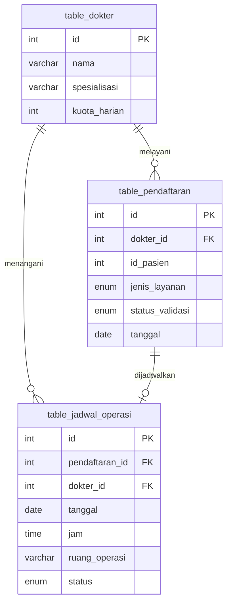

# Dokumentasi Master-Detail: Dashboard Dokter

## 1. Ringkasan

Fitur ini menampilkan data **dokter (master)** beserta **pendaftaran pasien** dan **jadwal operasi (detail)** dalam satu halaman. Halaman ini dibuka dari sidebar **Master Detail** pada dashboard, dan menampilkan kuota layanan dokter pada hari ini.

## 2. Desain Database

Database: `db_tugas_8_unit_test`



| Tabel | Peran | Keterangan |
|---|---|---|
| `table_dokter` | Master | Data dokter dan batas layanan harian (`kuota_harian` = 50) |
| `table_pendaftaran` | Detail 1 | Registrasi pasien. Setiap pendaftaran melayani satu dokter |
| `table_jadwal_operasi` | Detail 2 | Jadwal operasi untuk pendaftaran jenis Operasi |
| `table_menu` | Pendukung | Sidebar. Ditambah satu baris "Master Detail" |

Relasi: satu dokter bisa memiliki banyak pendaftaran (1:N), dan satu pendaftaran operasi hanya punya satu jadwal (1:0..1).

## 3. Aturan Bisnis

Dari kasus Rumah Sakit:

| Aturan | Nilai | Status di sample ini |
|---|---|---|
| Layanan dokter umum per hari | maksimal 50 | Ditampilkan sebagai kuota (`terpakai / maksimal`) |
| Ruang operasi per hari | 2 ruangan (OK-1, OK-2) | Dirancang di kolom `ruang_operasi`; validasi untuk modul registrasi |
| Dokter operasi | 8 orang | Data dokter sample berjumlah 8 |
| Rawat inap | 40 kamar: Kelas I 10, Kelas II 10, Kelas III 20 | Dirancang untuk modul registrasi |
| Rawat inap | jumlah pasien ≤ kamar tersedia | Dirancang untuk modul registrasi |
| Operasi | jumlah kebutuhan ≤ ruang operasi tersedia | Dirancang untuk modul registrasi |

Kuota hari ini dihitung dari pendaftaran dengan tanggal hari ini dan status **tidak** `Rejected`.

## 4. Arsitektur

```
Browser (Angular, localhost:4200)
   │
   ├─ Dashboard (sidebar dari table_menu)
   │     └─ MasterDetailComponent  ──>  MasterDetailService
   │                                         │ GET
   └────────────────────────────────────────  ▼
                                   http://localhost/Unit_test/api-master-detail.php?id=5
                                             │ mysqli (prepared statement)
                                             ▼
                                   MySQL: db_tugas_8_unit_test
```

## 5. API

**Endpoint:** `GET http://localhost/Unit_test/api-master-detail.php?id={id}`

Contoh respons (`id=5`):

```json
{
  "dokter": { "id": 5, "nama": "dr. Elvan Li, Sp.B", "spesialisasi": "Bedah Umum", "kuota_harian": 50 },
  "kuota": { "terpakai": 2, "maksimal": 50 },
  "pendaftaran": [
    { "id": 1001, "dokter_id": 5, "id_pasien": 8821, "jenis_layanan": "Operasi", "status_validasi": "Approved", "tanggal": "2026-10-26" },
    { "id": 1002, "dokter_id": 5, "id_pasien": 8822, "jenis_layanan": "Rawat Jalan", "status_validasi": "Approved", "tanggal": "2026-10-26" }
  ],
  "jadwal_operasi": [
    { "id": 1, "pendaftaran_id": 1001, "dokter_id": 5, "tanggal": "2026-10-26", "jam": "08:00:00", "ruang_operasi": "OK-1", "status": "Terjadwal" }
  ]
}
```

| Kode | Kondisi | Pesan |
|---|---|---|
| 200 | Data ditemukan | - |
| 400 | `id` kosong, 0, atau bukan angka | `ID dokter tidak valid` |
| 404 | Dokter tidak ada | `Dokter tidak ditemukan` |
| 500 | Koneksi database gagal | `Koneksi gagal` |

## 6. Frontend

| File | Fungsi |
|---|---|
| `master-detail.service.ts` | Interface data dan pemanggilan API |
| `master-detail.component.ts` | Tampilan: input ID dokter, kartu dokter, kuota, tab Pendaftaran dan Jadwal Operasi |
| `dashboard.component.ts` | Menampilkan `<app-master-detail>` saat menu "Master Detail" dipilih |

Halaman dimuat otomatis dengan ID dokter 5. Tombol **Tampilkan** atau tombol Enter memuat dokter lain.

## 7. Cara Menjalankan

1. Jalankan Laragon, lalu **Start All** (Apache dan MySQL).
2. Buka phpMyAdmin dan jalankan `db/master_detail.sql` pada database `db_tugas_8_unit_test`.
3. Jalankan API JWT: `dotnet run --launch-profile https --urls https://localhost:7001` di folder `JwtLab`.
4. Jalankan Angular: `npm start` di folder proyek.
5. Buka `http://localhost:4200`, login, lalu klik **Master Detail** di sidebar.

## 8. Pengujian

| No | Skenario | Langkah | Hasil yang diharapkan |
|---|---|---|---|
| 1 | Data default | Buka menu Master Detail | Dokter #5, kuota 2 / 50, bar sekitar 4%, tab Pendaftaran (2) |
| 2 | Tab operasi | Klik "Jadwal Operasi" | Satu baris: ruang OK-1, jam 08:00 |
| 3 | Dokter lain | Isi ID 1, klik Tampilkan | Dokter #1, kuota 0 / 50, pendaftaran kosong |
| 4 | ID tidak ada | Isi ID 99 | Pesan "Dokter tidak ditemukan" |
| 5 | ID tidak valid | Isi ID 0 atau kosong | Pesan "ID dokter tidak valid" |
| 6 | Sidebar | Lihat menu | Ada item "Master Detail" setelah Settings |
| 7 | API langsung | Buka `http://localhost/Unit_test/api-master-detail.php?id=5` | JSON seperti contoh di bagian 5 |

## 9. Keterbatasan dan Pengembangan

- Halaman ini hanya **membaca** data. Penambahan pendaftaran dan validasi kuota 50, ruang operasi, serta kamar rawat inap akan dibuat di modul registrasi berikutnya.
- Endpoint belum dilindungi JWT. Untuk tugas ini, PHP dibiarkan publik seperti endpoint lain di tugas 8.
- Kuota hari ini dihitung berdasarkan tanggal server (`CURDATE()`). Data sample dibuat untuk tanggal saat `master_detail.sql` dijalankan.

## 10. Lampiran Screenshot

- Halaman Master Detail dengan dokter #5
- Tab Jadwal Operasi
- Respons API di browser
- Hasil uji ID tidak ditemukan
